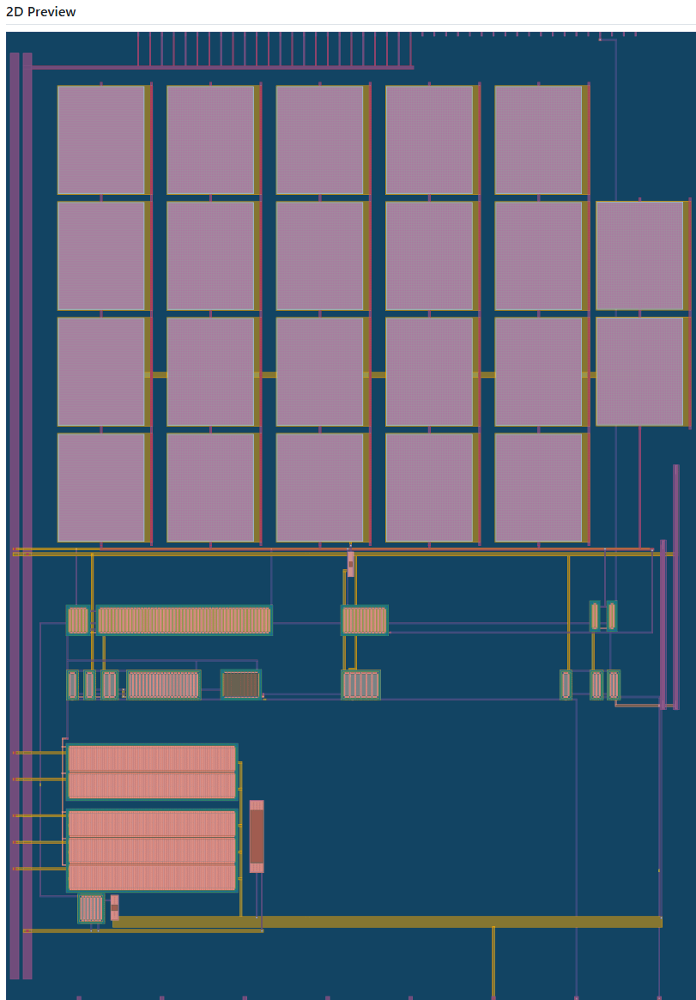
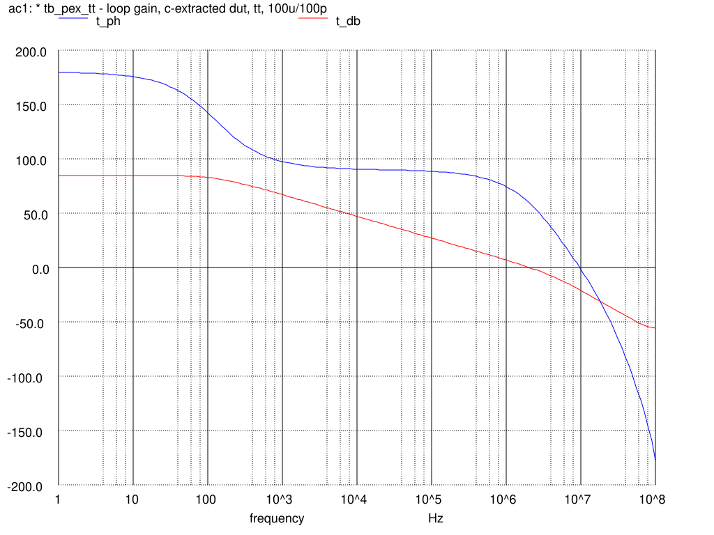
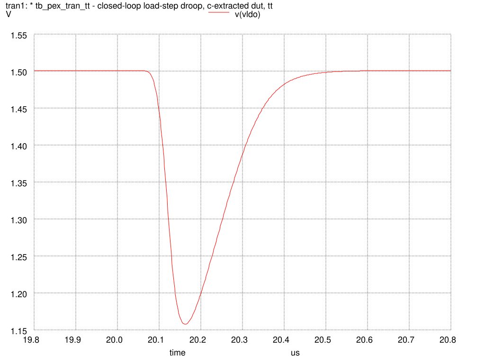

# TinyLDO — Capless 1.5 V LDO on SKY130

**Author:** Ashutosh Dubey
*Alternate version based on the original TinyLDO design by Billy Ouyang ([OGggggish/tt-ota-sky130](https://github.com/OGggggish/tt-ota-sky130)).*

A fully analog, capless 1.5 V low-dropout regulator for Tiny Tapeout on the SKY130 process. A two-stage Miller OTA drives a super-source-follower buffer, which drives a segmented PMOS pass device. Bias generation, the feedback divider, RC compensation and a switched demo load are all on-chip.



## Specifications

| Parameter | Value |
|---|---|
| Technology | SKY130A, Tiny Tapeout 1×2 analog tile |
| Input supply | 1.8 V |
| Output voltage | 1.5 V |
| Reference | 0.9 V external (`ua[0]`) |
| Bias | 10 µA external (`ua[1]`) |
| Design load | 1.1 mA continuous, ~2.8 mA switched demo load |
| Dropout | 14.8 mV @ 1.1 mA |
| DC loop gain | 84.8 dB (post-layout, tt) |
| Unity-gain frequency | 2.04 MHz (post-layout, tt) |
| Phase margin | 59.6° tt 27 °C / 51.8° ss 125 °C / 70.7° ff −40 °C |
| Load-step droop | −343 mV, full recovery (0.1 → 2.8 mA) |
| Output capacitor | None required |

LVS clean (netgen) and post-layout simulated across corners.

## Pinout

| Pin | Direction | Function |
|---|---|---|
| `ua[0]` | in | 0.9 V reference |
| `ua[1]` | in | 10 µA bias current |
| `ua[2]` | out | Regulated 1.5 V output |
| `ui_in[0]` | in | Enable on-chip demo load |

## Simulation results

Loop gain, post-layout, tt corner:



Load-step transient:



## Repository layout

```
src/schematics/   xschem schematics and SPICE netlist
src/layout/       magic layout (top cell + subcells)
gds/, lef/        submission files
lvs/              LVS netlists and report
sim/              post-layout testbenches, logs and plots
docs/             design notes (info.md), pre-layout sims, layout preview
```

## Tools

xschem, ngspice, magic, netgen, KLayout (via IIC-OSIC-TOOLS).

## License

See [LICENSE](LICENSE).
